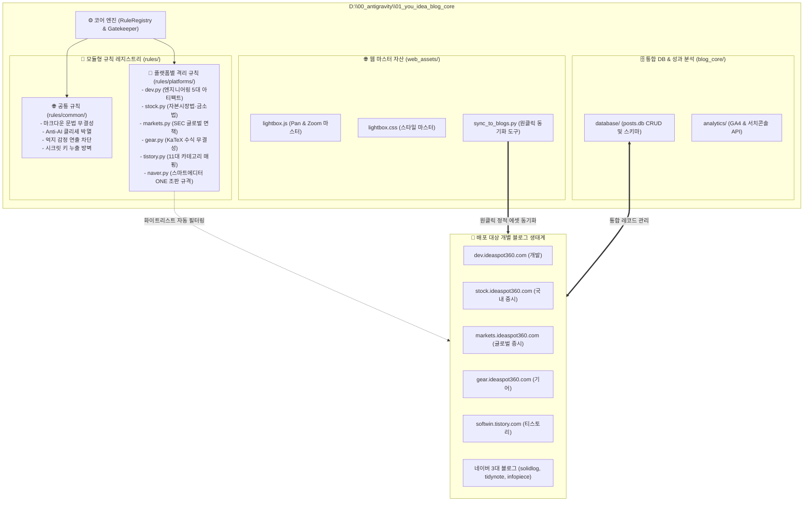

# 🏛️ 01_you_idea_blog_core - 통합 블로그 에코시스템 코어 아키텍처

> **중앙 관제 및 공통 라이브러리 (Single Source of Truth & Plugin Registry)**  
> 사설 멀티 블로그(`dev`, `gear`, `stock`, `markets`) 및 티스토리(`softwin`), 네이버 3대 전문 블로그(`solidlog`, `tidynote`, `infopiece`)가 공유하는 **플러그인 기반 검증 엔진, 웹 자산 동기화 파이프라인, 통합 데이터베이스 및 성과 분석 모듈**의 마스터 저장소입니다.

---

## 🎯 1. 시스템 핵심 철학 및 당위성

1. **단일 원천 원칙 (DRY, Single Source of Truth)**:
   * 검증 엔진(`IroncladGatekeeper`), 마스터 웹 자산(`lightbox.js/css`), DB 모델(`posts.db`)을 단 한 곳에서만 관리하여 코드 파편화(Code Drift)를 원천 박멸합니다.
2. **플러그인 기반 완전 격리 (Zero Cross-Blog Impact)**:
   * 특정 블로그에 필요한 규칙을 추가하거나 수정하더라도, **타 블로그 실행에 0.001%의 회귀 버그나 상호 영향이 없는 완벽한 물리적 격리**를 보장합니다.
3. **무한 확장성 (Auto-Discovery)**:
   * 신규 블로그(예: `talk`, `recipe` 등)나 신규 규칙 추가 시 코어 엔진 코드를 단 한 줄도 수정할 필요 없이, 규칙 파일 생성만으로 자동 인식(Auto-discovery)되어 즉시 검증 파이프라인에 편입됩니다.

---

## 🏛️ 2. 시스템 아키텍처 다이어그램



---

## 📂 3. 디렉터리 구조

```text
D:\00_antigravity\01_you_idea_blog_core\
├── pyproject.toml                     <-- 로컬 패키지 설정 (pip install -e .)
├── README.md                          <-- 마스터 아키텍처 설명서 (본 문서)
├── sync_to_blogs.py                   <-- 원클릭 전 블로그 웹 에셋 동기화 파이프라인
│
├── blog_core/                         <-- 파이썬 표준 임포트 패키지
│   ├── __init__.py                    <-- 패키지 진입점 및 편의 함수 내보내기
│   ├── engine/                        <-- 코어 실행 엔진
│   │   ├── base_rule.py               <-- BaseRule 베이스 클래스
│   │   ├── context.py                 <-- RuleContext (문서 메타데이터 및 본문 파서)
│   │   ├── models.py                  <-- Violation, GateReport, Severity 데이터 모델
│   │   ├── registry.py                <-- Auto-discovery 규칙 등록 엔진
│   │   └── gatekeeper.py              <-- IroncladGatekeeper 통합 검증기 & CLI
│   │
│   ├── rules/                         <-- 플러그인 규칙 모듈
│   │   ├── common/                    <-- 전 블로그 공통 적용 룰 (Anti-AI, Markdown, Secrets)
│   │   └── platforms/                 <-- 블로그별 독립 격리 룰 (dev, stock, markets, gear, ...)
│   │
│   ├── database/                      <-- SQLite 통합 데이터베이스 모듈
│   │   ├── connection.py              <-- DB 커넥션 풀 & 세션 관리
│   │   ├── schema.py                  <-- blog_posts, post_analytics 스키마
│   │   └── operations.py              <-- CRUD 및 트랜잭션 오퍼레이션
│   │
│   └── analytics/                     <-- 성과 분석 공통 모듈
│       ├── ga4.py                     <-- GA4 Data API 연동기
│       ├── search_console.py          <-- Google Search Console API 연동기
│       └── resolver.py                <-- 도메인/속성 ID 매핑 리졸버
│
├── web_assets/                        <-- 프론트엔드 단일 마스터 자산
│   ├── js/lightbox.js                 <-- Pan & Zoom 5px 드래그 방어 라이트박스
│   └── css/lightbox.css               <-- 풀스크린 뷰어 및 툴바 스타일
│
├── docs/                              <-- 상세 문서 보관소
│   └── AGENT_EXTENSION_GUIDE.md       <-- 타 블로그 에이전트 전용 확장 지침서
│
└── tests/                             <-- 단위 및 E2E 테스트 스위트 (200+ 테스트)
```

---

## 🚀 4. 빠른 시작 가이드 (Quick Start)

### (1) 로컬 패키지 설치
어느 워크스페이스에서든 본 코어 패키지를 표준 라이브러리처럼 호출하려면 터미널에서 다음 명령어를 1회 실행합니다:

```powershell
python -m pip install -e D:\00_antigravity\01_you_idea_blog_core
```

### (2) 파이썬 코드에서 게이트키퍼 호출
```python
from blog_core import IroncladGatekeeper, verify_or_abort

# 1. 즉시 검증 및 실패 시 프로세스 차단 (발행 CLI용)
verify_or_abort("posts/my_post.md", platform="tistory")

# 2. 검증 보고서 객체 활용
gk = IroncladGatekeeper()
report = gk.verify("posts/my_post.md", platform="dev")
print(f"점수: {report.score} / 100, 통과 여부: {report.is_passed}")
```

### (3) 웹 에셋 원클릭 동기화
코어의 `web_assets/`에서 라이트박스 JS/CSS를 수정한 후, 모든 블로그 레포지토리로 즉시 반영합니다:

```powershell
# 1. 변경 미리보기 (Dry-run)
python sync_to_blogs.py --dry-run

# 2. 실제 전 블로그 동기화 실행
python sync_to_blogs.py
```

---

## 📖 5. 타 블로그 에이전트 확장 가이드
새로운 블로그 플랫폼을 추가하거나 기존 블로그에 특화 룰을 안전하게 확장하는 방법은 [docs/AGENT_EXTENSION_GUIDE.md](file:///D:/00_antigravity/01_you_idea_blog_core/docs/AGENT_EXTENSION_GUIDE.md)를 참조하십시오.
